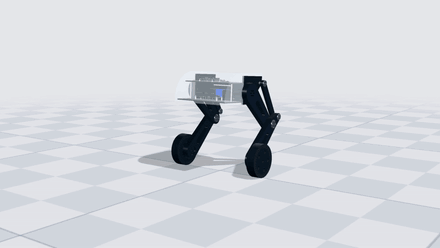
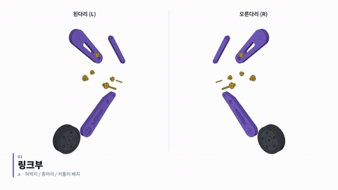

# TWLR — 2륜 밸런싱 로봇 (한국항공대 캡스톤디자인)

<table>
<tr>
<td width="50%" align="center"><a href="hardware/media/motion-showcase.mp4"></a></td>
<td width="50%" align="center"><a href="hardware/media/assembly-animation-v2.mp4"></a></td>
</tr>
<tr>
<td align="center"><b>모션 쇼케이스</b> — SQUAT · ROLL · DRIVE · TURN<br><sub>서보 축 높이 340–510 mm · 좌우 독립 롤 · 도립진자 밸런싱 주행 · 선회 시 기울기 보정</sub><br><a href="hardware/media/motion-showcase.mp4">▶ 원본 영상 (42 s)</a></td>
<td align="center"><b>어셈블리</b> — 링크부 → 토르소부 → 링크부 + 몸체<br><sub>좌우 4절 링크 다리 · 상·하판 서브어셈블리 · 커플러 부시 샤프트 체결</sub><br><a href="hardware/media/assembly-animation-v2.mp4">▶ 원본 영상 (36 s)</a></td>
</tr>
</table>

<sub>GIF 는 1.5~2 배속 미리보기입니다. 클릭하면 원본 mp4 로 이동합니다.</sub>

> **최근 변경 (2026-10)**
> - **Gazebo 시뮬레이션 추가** — CATIA 기반 새 URDF(9.62 kg) + 균형 제어기 `sim/`, 검증 결과 · CAD(11.24 kg) 와의 차이 · 열린 항목 → [sim](sim/) · [시뮬레이션 문서](docs/simulation/)
> - **2학기 통합본 발표 추가** — 1~3주차를 주제별로 재구성하고, CAN 통합 구동 계획 · 코드 원리 · 운용 방법을 새로 정리 → [발표](docs/presentations/2026-2-integrated/) · [전장 · 제어 문서](docs/electronics/)
> - 고관절 액추에이터를 CubeMars AK45-36 → **Damiao DM-J4340P-2EC** 로 교체 (AK45 배송 지연). 토크 해석 재계산, 구매 BOM, 2·3주차 발표자료, 모션 쇼케이스·어셈블리 v2 영상 추가.

**처음 보신다면** — ① 위 영상 → ② [기구 설계 요약](#기구-설계-요약) → ③ [해석 결과](#핵심-해석-결과) → ④ [전장 · 제어](#전장--제어--can-통합-구동-계획) → ⑤ [발표자료](#발표자료-2026-2학기)

이 저장소는 세 부분으로 나뉩니다.

| | 내용 | 진입점 |
|---|---|---|
| **기구 설계 (CAD)** | CATIA, Fusion 360 어셈블리, 3D 프린팅 STL, 구조·정역학 해석 | **[`hardware/`](hardware/)** |
| **전장 · 제어** | CAN 통합 구동 계획(DM4340P · ODrive · IMU → Teensy 500 Hz → ROS 2), 제어 원리, 운용 방법, 설정 스크립트 | [`docs/electronics/`](docs/electronics/) · [`firmware/`](firmware/) · [`host/`](host/) |
| **ROS 2 · 시뮬레이션** | 새 URDF + Gazebo Harmonic 균형 시뮬레이션, 구버전 Fusion URDF | [`sim/`](sim/) · [`docs/simulation/`](docs/simulation/) · 구버전: [`urdf/`](urdf/) · [아래 섹션](#ros-2-robot-description) |

---

## 기구 설계 요약

전체 문서 → [`hardware/README.md`](hardware/README.md)

| | |
|---|---|
| **Fusion 문서** | `TWLR_assembly_AK45` (컴포넌트 31 / 오컬런스 55 / 타임라인 281) — 고관절 인터페이스는 아직 AK45 기준 |
| **총질량** | **11.24 kg** (PLA 벽 6줄 / 인필 20 %, DM4340P 반영) |
| **무게중심** | 지면 위 **271.5 mm**, 휠축 위 **185.5 mm**, 좌우 대칭 X = 0.000 mm |
| **고관절** | Damiao **DM-J4340P-2EC** × 2 (40:1, CAN) |
| **휠** | **WA172E** 인휠모터 Ø172 × 2 (4-M6 PCD36 체결) |
| **다리** | 좌우 **4절 링크**, 기구학 한계 Δθ = −27.1° … +36.1° · 팀 권장 운용범위 −20.9° … +21.6° (3주차) |
| **전장** | LattePanda (상위) · Teensy 4.1 (하위) · BNO085 IMU · CAN 트랜시버 · ODrive (휠) |

**영상** — [모션 쇼케이스 — SQUAT · ROLL · DRIVE · TURN](hardware/media/motion-showcase.mp4) (42 s) ·
[어셈블리 v2](hardware/media/assembly-animation-v2.mp4) (36 s) ·
[토르소 출력 시뮬레이션](hardware/media/torso-print-sim-cura.mp4) ·
[어셈블리 v1](hardware/media/assembly-animation.mp4) (27 s)

**상세 문서** — [01 고관절 AK45 (이전안)](docs/mechanical/01-hip-actuator-AK45.md) ·
[02 조인트/부시/샤프트](docs/mechanical/02-joints-bushings-shafts.md) ·
[03 질량·무게중심·힙토크](docs/mechanical/03-mass-cog-hip-torque.md) ·
[04 3D프린팅 방향·인필](docs/mechanical/04-print-orientation-infill.md) ·
[**05 고관절 DM4340P 변경**](docs/mechanical/05-hip-actuator-DM4340P.md) ·
[구매 BOM](hardware/bom/)

## 핵심 해석 결과

모든 수치는 `hardware/analysis/`의 스크립트로 재현됩니다.

| 항목 | 결과 | 상세 |
|---|---|---|
| 고관절 필요토크 (직립, Δθ = 0) | **9.59 N·m** — DM4340P 정격 9 N·m 의 107 %, 피크 27 N·m 의 36 % | [05](docs/mechanical/05-hip-actuator-DM4340P.md) |
| 링크 굽힘 (3G 착지) | 눕혀 출력 시 안전율 **1.65** / 세워 출력 시 1.21 | [04](docs/mechanical/04-print-orientation-infill.md) |
| 고관절 캔틸레버 | 정지 6.54 / 3G 19.61 N·m vs 베어링 ≈ 27.6 N·m (AK45 기준) | [02](docs/mechanical/02-joints-bushings-shafts.md) |
| 간섭 해석 (55 오컬런스) | 실질 간섭 **0건** | [01](docs/mechanical/01-hip-actuator-AK45.md) |

> **열려 있는 항목 6건**(토르소 실측 질량, DM4340P 설치도면 반영 등)은 [`hardware/README.md` §6](hardware/README.md#6-미해결--판단-필요)에 숨기지 않고 적어 두었습니다.

## 전장 · 제어 — CAN 통합 구동 계획

**Teensy 4.1 이 CAN1(고관절) · CAN2(휠) · I²C(IMU)를 500 Hz 로 직접 돌리고, LattePanda 는 ROS 2 로 명령 · 기록만 맡습니다.**
상태: 휠 · IMU 단품 구동 확인 → 고관절 DM4340P 입고 후 bring-up 8단계 진행 예정 (2026-10 기준)

| 항목 | 내용 |
|---|---|
| **버스** | CAN1 1 Mbps — DM4340P × 2 (MIT 모드) · CAN2 1 Mbps — ODrive 2축 (토크 모드) · ID 충돌을 피하려 분리, 부하 약 25 % |
| **밸런싱** | 바퀴 달린 역진자 + LQR — Q = diag(5, 2, 200, 5), R = 1 → K = 2.24 / 4.10 / 28.4 / 4.59, 휠 토크 ±8 N·m |
| **고관절** | MIT 모드 Kp 40 · Kd 1.5(공중) / 3.0(서기) + 높이별 중력보상 × 0.8, 기본 높이 455 mm (정격 9 N·m 연속 영역) |
| **안전** | 상태머신 BOOT → IDLE → CALIB → READY → BALANCE / FAULT, 3중 워치독 (ROS 250 ms · DM 100 ms · ODrive 0.2 s) |
| **ROS 2** | USB 시리얼 패킷(CRC16) — Command 50 Hz / Telemetry 100 Hz → `/imu/data` · `/joint_states` · `/odom` |

**문서** — [01 CAN 통합 구동 계획](docs/electronics/01-can-integration-plan.md) ·
[02 코드 해설 · 원리 · 이론](docs/electronics/02-control-principles.md) ·
[03 운용 방법](docs/electronics/03-operation-manual.md) ·
설정: [ODrive CAN](host/odrive_can_setup.odrivetool.py) · [DM4340P](host/dm4340p_setup.md)

## Gazebo 시뮬레이션

**Ubuntu 24.04 + ROS 2 Jazzy + Gazebo Harmonic.** CATIA 어셈블리에서 만든 URDF 에 바퀴 달린 역진자 균형 제어기(속도 PI → pitch PD → 바퀴 토크)를 붙였습니다. 1단계는 다리 고정, 4절 링크를 움직이는 2단계는 아직 검증 전입니다.

| 항목 | 내용 |
|---|---|
| **패키지** | [`sim/twlr_description`](sim/twlr_description/) (모델 · 월드 · 브리지) · [`sim/twlr_control`](sim/twlr_control/) (제어기) |
| **실행** | 두 폴더를 `~/twlr/src` 로 복사 → `colcon build --symlink-install` → `ros2 launch twlr_control balance_sim.launch.py` |
| **모델 값** | 총 **9.62 kg**(아크릴 제외 9.10) · 균형 pitch **5.79°**(8.16°) · 무게중심 지면 위 243.6 mm · 바퀴 Ø172 · 간격 488.2 mm |
| **제어기 기본값** | kp_pitch 30 · kd_pitch 4 · kp_vel 0.3 · ki_vel 0.5 · 휠 토크 한계 10 N·m |
| **검증 (Gazebo 없이)** | −6° ~ +15° 시작 · 0.6 m/s 밀침 회복 · 센서→토크 지연 50 ms · kp 18 ~ 45 · kd 3 ~ 8 안정 — **실제 Gazebo 구동은 미확인** |
| **주의** | URDF 9.62 kg 과 CAD 해석 모델 11.24 kg 이 다름 · LQR 모델(극점 ±7.59)과 URDF 선형화(±6.54)도 다름 |

**문서** — [01 구성 · 실행 · 값](docs/simulation/01-gazebo-simulation.md) ·
[02 검증 결과 · CAD 와의 차이 · 열린 항목](docs/simulation/02-verification-and-open-items.md) ·
재현: [`sim/verify/`](sim/verify/)

## 발표자료 (2026-2학기)

| 주차 | 발표일 | 제목 | 주요 내용 |
|---|---|---|---|
| [1주차](docs/presentations/2026-2-week1/) | 09-07 | 하드웨어 제작·설계 및 시뮬레이션 결과 보고 | Simulink, 부시·샤프트, 모터 구동 |
| [2주차](docs/presentations/2026-2-week2/) | 09-14 | 하드웨어 제작 및 시뮬레이션 결과 보고 | Simulink(CoM·피치), 모션 시뮬레이션, 부시 최소길이, 링크 3D 프린팅, 모듈 구동 |
| [3주차](docs/presentations/2026-2-week3/) | 09-21 | 하드웨어 제작 및 센서 구동 테스트 | 구동각 제한(조립·간섭·전달각), 정역학·동역학, LattePanda 휠 구동, BNO085 IMU |
| [**통합본**](docs/presentations/2026-2-integrated/) | 10월 | 2학기 하드웨어 통합 보고 + CAN 구동 · 해설 · 운용 (110장) | 1~3주차 주제별 재구성, 토르소 제작 현황, **CAN 통합 계획 · 코드 원리 · 운용 방법** |

---

# ROS 2 Robot Description

> 새 CATIA 기반 URDF 는 [`sim/twlr_description`](sim/twlr_description/) 에 있습니다 (9.62 kg, Gazebo 시뮬레이션용 · CAD 모델과의 차이는 [docs/simulation/02](docs/simulation/02-verification-and-open-items.md#3-시뮬-urdf-와-cad-모델의-차이)).
>
> ⚠️ **아래 URDF 는 구버전 Fusion 모델에서 자동생성된 것입니다.**
> 질량 63.541 kg, 링크명 `link1`/`link3` 등은 현재 CAD(`TWLR_assembly_AK45`, DM4340P 반영 11.24 kg)와 맞지 않습니다.
> 기구가 확정되었으므로 URDF 재생성이 필요합니다 — 실제 질량·관성값은
> [`hardware/analysis/results/mass-and-cog.txt`](hardware/analysis/results/mass-and-cog.txt) 참고.

## Table of Contents

- [Overview — 구버전 URDF](#overview--구버전-urdf)
- [Assembly Breakdown — CAD 실측 질량](#assembly-breakdown--cad-실측-질량)
- [Quick Start (ROS 2)](#quick-start-ros-2)
- [Files](#files)
- [Customizing](#customizing)

## Overview — 구버전 URDF

| Property | Value |
|----------|-------|
| Total mass | 63.541 kg *(실제 11.24 kg)* |
| Links | 7 |
| Joints | 6 (6 movable) |
| Assemblies | 14 |
| Root link | `base_link` |

<details>
<summary><b>Kinematic Tree · Link / Joint Properties</b> (구버전 자동생성값 — 참고용, 펼쳐서 보기)</summary>

### Kinematic Tree

```
base_link
  └─ hip_right [continuous]
    link1_right [BAKE]
      └─ knee_right [continuous]
        link3_right [BAKE]
          └─ wheel_right [continuous]
            wheel_right [BAKE]
      └─ hip_left [continuous]
        link1_left [BAKE]
          └─ knee_left [continuous]
            link3_left [BAKE]
              └─ wheel_left [continuous]
                wheel_left [BAKE]
```

### Link Properties

| Link | Mass (kg) | Material | Collision | Bodies |
|------|-----------|----------|-----------|--------|
| `base_link` | 46.8047 | material | cylinder | 1 |
| `link1_left` | 0.6681 | material | box | 1 |
| `link1_right` | 0.6681 | material | box | 1 |
| `link3_left` | 0.8086 | material | cylinder | 1 |
| `link3_right` | 0.8086 | material | cylinder | 1 |
| `wheel_left` | 6.8914 | material | box | 2 |
| `wheel_right` | 6.8914 | material | box | 2 |

### Joint Properties

| Joint | Type | Parent → Child | Axis | Limits |
|-------|------|---------------|------|--------|
| `hip_left` | continuous | `link1_right` → `link1_left` | (1,0,0) | — |
| `hip_right` | continuous | `base_link` → `link1_right` | (1,0,0) | — |
| `knee_left` | continuous | `link1_left` → `link3_left` | (1,0,0) | — |
| `knee_right` | continuous | `link1_right` → `link3_right` | (1,0,0) | — |
| `wheel_left` | continuous | `link3_left` → `wheel_left` | (-0,0,-1) | — |
| `wheel_right` | continuous | `link3_right` → `wheel_right` | (0,-0,-1) | — |

</details>

## Assembly Breakdown — CAD 실측 질량

> 위 구버전 URDF 가 아니라, 실제 Fusion 360 모델(`TWLR_assembly_AK45`,
> [`hardware/cad/TWLR_assembly_AK45.f3d`](hardware/cad/TWLR_assembly_AK45.f3d))에서 측정한 질량 특성입니다.
> PLA 부품은 **벽 6줄(2.4 mm) + 인필 20 %** 셸 모델 기준
> (`f = (V_shell + infill·(V−V_shell)) / V`), 구매품(DM4340P·WA172E·배터리 등)은 데이터시트/실측값.
> 고관절 액추에이터는 **DM4340P 375 g** 으로 갱신 (형상·중심은 CAD 의 AK45 자리값 사용 — 외형 Ø57 vs Ø55, 길이 동일).
> 좌표는 **고관절 축 원점** 기준 mm (X 좌우, Y 전후, Z 상하).
> 재현: [`hardware/analysis/mass_cog.py`](hardware/analysis/mass_cog.py) ·
> 원본 출력: [`hardware/analysis/results/mass-and-cog.txt`](hardware/analysis/results/mass-and-cog.txt)

### 전체 합계

| 항목 | 값 |
|---|---|
| 그룹 BODY | 4.615 kg |
| 그룹 THIGH | 1.149 kg |
| 그룹 SHIN | 5.300 kg |
| 그룹 COUP | 0.176 kg |
| **총질량** | **11.239 kg** (AK45 기준 11.187 kg) |
| **무게중심** | **(−0.0, 11.4, −150.5) mm** — 고관절 축 원점 기준 |
| 지면(휠 반경 86 mm) 기준 CoG 높이 | **271.5 mm** |

<details>
<summary><b>그룹별 부품 표</b> — BODY · THIGH · SHIN · COUP (펼쳐서 보기)</summary>

### BODY — 토르소 · 배터리 · 전장 · 고관절 액추에이터 (4.615 kg)

| 부품 | 체적 [cm³] | 재료 | 유효충전율 | 질량 [g] | 중심 (X, Y, Z) mm |
|---|---:|---|---:|---:|---|
| Part12 토르소 메인 | 1486.1 | PLA | 65.4% | 1204.4 | (0.0, 47.9, −1.4) |
| Part14 외장/프레임 | 1040.8 | PLA | 88.2% | 1138.5 | (0.0, −81.4, 43.4) |
| Part13 배터리 (6S LiPo) | 301.9 | BATT | 실측 | 700.0 | (0.0, 0.0, −7.7) |
| Part16 하부 패널 | 282.3 | PLA | 100.0% | 350.0 | (0.0, −74.0, −46.2) |
| 20_ACT DM4340P L | 132.9 | DM4340P | 데이터시트 | 375.0 | (−111.9, −0.1, 0.0) |
| 20_ACT DM4340P R | 132.9 | DM4340P | 데이터시트 | 375.0 | (111.9, 0.1, 0.0) |
| Part15 상부 패널 | 260.9 | PLA | 100.0% | 323.6 | (0.0, −22.0, 46.2) |
| Driver PCB v3.5 | 34.5 | PCB | 100% | 65.5 | (−3.1, −124.8, −28.4) |
| PCB | 8.5 | PCB | 100% | 16.1 | (−0.3, −66.4, 50.3) |
| Carte PCB | 1.6 | PCB | 100% | 3.1 | (60.3, 0.2, 49.0) |

### THIGH — 허벅지 링크 · 출력 허브 · 베어링 (1.149 kg, 좌우 대칭)

| 부품 | 체적 [cm³] | 재료 | 유효충전율 | 질량 [g] | 중심 (X, Y, Z) mm |
|---|---:|---|---:|---:|---|
| 06_Thigh_L | 604.8 | PLA | 45.7% | 342.5 | (−187.1, 73.6, −69.3) |
| 08_Thigh_R | 604.8 | PLA | 45.7% | 342.5 | (187.1, 73.6, −69.3) |
| 21_HUB L (출력 허브) | 49.1 | AL6061 | 100% | 132.4 | (−162.8, 0.0, 0.0) |
| 21_HUB R | 49.1 | AL6061 | 100% | 132.4 | (162.8, 0.0, 0.0) |
| 6905 베어링 ×4 (25×42×9) | 6.3 ea | STEEL | 100% | 49.8 ea | X = ∓177.5 / ∓186.5 |

### SHIN — 종아리 링크 · 인휠모터 · 베어링/부시 (5.300 kg, 좌우 대칭)

| 부품 | 체적 [cm³] | 재료 | 유효충전율 | 질량 [g] | 중심 (X, Y, Z) mm |
|---|---:|---|---:|---:|---|
| 10_Wheel_WA172E_L | 947.4 | WA172E | 실측 | 2200.0 | (−257.6, 4.0, −336.0) |
| 11_Wheel_WA172E_R | 947.4 | WA172E | 실측 | 2200.0 | (257.6, 4.0, −336.0) |
| 07_Shin_L | 577.9 | PLA | 50.8% | 364.4 | (−213.9, 106.7, −234.9) |
| 09_Shin_R | 577.9 | PLA | 50.8% | 364.4 | (213.9, 106.7, −234.9) |
| 6904 베어링 ×4 (20×37×9) | 5.4 ea | STEEL | 100% | 42.3 ea | X = ∓215.5 / ∓224.5, (Y,Z)=(174.0,−164.0) |
| bush @B (플랜지 부시) ×2 | 0.8 ea | iglidur | 100% | 1.2 ea | X = ∓165.0, (Y,Z)=(228.5,−128.6) |

### COUP — 보조링크 · 부시 (0.176 kg, 좌우 대칭)

| 부품 | 체적 [cm³] | 재료 | 유효충전율 | 질량 [g] | 중심 (X, Y, Z) mm |
|---|---:|---|---:|---:|---|
| 02_Coupler_L | 116.2 | PLA | 60.2% | 86.7 | (−162.0, 169.3, −36.7) |
| 03_Coupler_R | 116.2 | PLA | 60.2% | 86.7 | (162.0, 169.3, −36.7) |
| bush @A (플랜지 부시) ×2 | 0.8 ea | iglidur | 100% | 1.2 ea | X = ∓165.0, (Y,Z)=(114.0,49.0) |

</details>

## Quick Start (ROS 2)

```bash
# 1. Copy package to your ROS 2 workspace
cp -r TWLR_description ~/ros2_ws/src/

# 2. Build
cd ~/ros2_ws
colcon build --packages-select TWLR_description
source install/setup.bash

# 3. Visualize in RViz2
ros2 launch TWLR_description display.launch.py

# 4. Validate URDF structure
check_urdf install/TWLR_description/share/TWLR_description/urdf/TWLR.urdf

# 5. Print kinematic tree
urdf_to_graphviz install/TWLR_description/share/TWLR_description/urdf/TWLR.urdf
```

**Joint control**: The launch file includes `joint_state_publisher_gui` —
use the sliders to move revolute/prismatic joints in RViz2.

**Topic inspection**:
```bash
# See published joint states
ros2 topic echo /joint_states

# See robot description parameter
ros2 param get /robot_state_publisher robot_description
```

## Files

| Path | Description |
|------|-------------|
| `urdf/TWLR.urdf.xacro` | Top-level xacro (entry point) |
| `urdf/TWLR.urdf` | Flat URDF (for validation) |
| `urdf/assemblies/` | Per-assembly xacro macros |
| `meshes/` | Visual (OBJ) and collision (STL) meshes |
| `launch/display.launch.py` | Launch robot_state_publisher, RViz, and generated controllers |
| `config/joint_state.yaml` | Joint state publisher config |
| `config/ros2_controllers.yaml` | Generated ros2_control controller manager config |
| `robot_data.yaml` | Supplementary data (beyond URDF) |
| `docs/transforms.md` | Transformation matrices (KaTeX) |
| `docs/setup-guides/` | Fusion 360 MCP 연결 · URDF 변환 가이드 |
| `hardware/` | **기구 설계 — CAD, STL, 해석** |
| `hardware/cad/TWLR_assembly_AK45.f3d` | Fusion 360 어셈블리 원본 |
| `hardware/cad/step/` | 신규 가공품 STEP (허브·마운트링·샤프트 3종) |
| `hardware/print/print-ready/` | 슬라이서용 STL — 구멍 없음 + 눕힘 + 베드 최적 회전 |
| `hardware/print/as-designed/` | 설계 그대로의 STL (구멍 포함) |
| `hardware/analysis/` | 질량·힙토크·볼트·프린팅 강도 해석 스크립트 + 결과 |
| `hardware/media/` | 어셈블리 애니메이션 v1·v2, 모션 쇼케이스, 토르소 출력 시뮬레이션 |
| `hardware/bom/` | 구매 BOM (xlsx + 요약) |
| `docs/mechanical/` | 기구 설계 상세 문서 5편 (05 = DM4340P 변경) |
| `firmware/` | Teensy 4.1 펌웨어 (BNO085 쿼터니언 송신) |
| `host/` | LattePanda/Ubuntu 측 코드 (IMU 수신·파싱, ODrive 휠 설정, **ODrive CAN · DM4340P 1회 설정**) |
| `docs/electronics/` | 전장 · 제어 문서 3편 (CAN 통합 계획 · 코드 원리 · 운용 방법) |
| `docs/presentations/2026-2-week{1,2,3}/` | 2026-2학기 주차별 발표자료 (슬라이드·PDF·영상) |
| `docs/presentations/2026-2-integrated/` | 2026-2학기 통합본 발표 (110장, 슬라이드·PDF) |

## Customizing

Assemblies tagged `!dummy_` are designed to be swapped out. To replace one:

1. Create your replacement as a xacro macro with the same interface
2. Place it in `urdf/assemblies/`
3. Update the `<xacro:include>` in `urdf/TWLR.urdf.xacro`
4. Update meshes in `meshes/<your_assembly>/`

The xacro prefix system (`${prefix}`) ensures link names stay unique
when multiple instances of the same assembly are used.

---
*Generated by Fusion URDF/XACRO Exporter v3.0.0*
