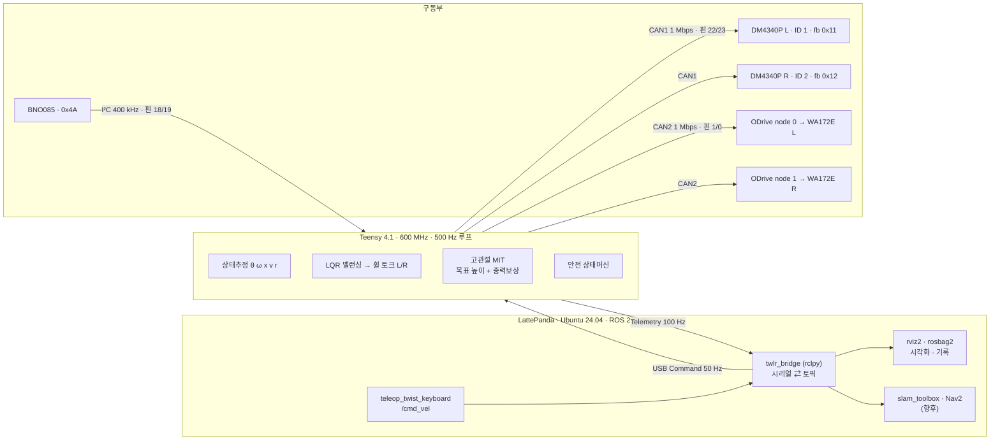
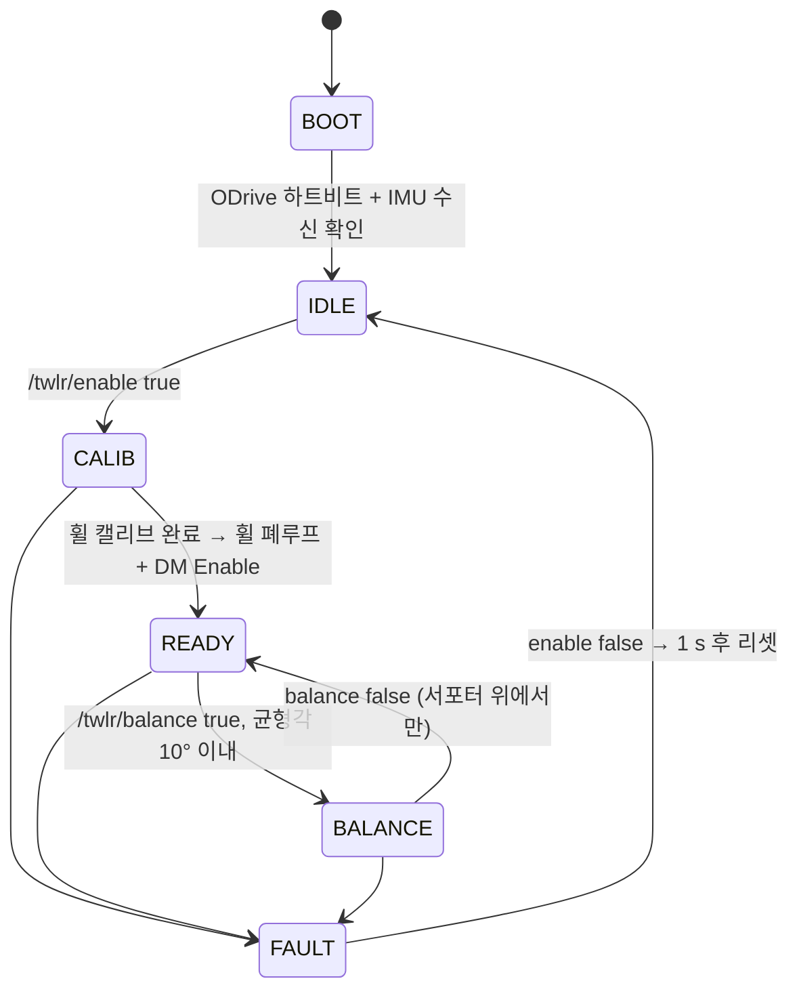

# 01 — CAN 통합 구동 계획 (DM4340P · ODrive · IMU → Teensy 500 Hz → ROS 2)

> 상태: **설계 완료 · 실물 bring-up 전 (2026-10)** — 단품 구동(휠·IMU)은 확인, 고관절 DM4340P 는 입고 후 미시험
> 출처: [2학기 통합본 발표](../presentations/2026-2-integrated/) PART 06 (슬라이드 55–76)
> 이어지는 문서: [02 코드 해설 · 원리](02-control-principles.md) · [03 운용 방법](03-operation-manual.md)

**한 줄 요약** — Teensy 4.1 이 CAN1(고관절) · CAN2(휠) · I²C(IMU)를 **500 Hz** 로 직접 돌리고,
LattePanda 는 ROS 2 로 명령 · 기록만 맡는다. 밸런싱 루프가 USB · 리눅스 지연에 영향받지 않게 하려는 구조다.

## 목차

1. [현황](#1-현황)
2. [전장 구성](#2-전장-구성)
3. [시스템 구조](#3-시스템-구조)
4. [전원 · 배선](#4-전원--배선)
5. [CAN 버스 설계](#5-can-버스-설계)
6. [DM4340P · ODrive 프로토콜과 설정](#6-dm4340p--odrive-프로토콜과-설정)
7. [Teensy 펌웨어 구조](#7-teensy-펌웨어-구조)
8. [밸런싱 · 고관절 제어 법칙](#8-밸런싱--고관절-제어-법칙)
9. [Teensy ⇄ ROS 2](#9-teensy--ros-2)
10. [config.h 값](#10-configh-값)
11. [Bring-up 8단계 · 일정](#11-bring-up-8단계--일정)
12. [안전 · 추가 구매](#12-안전--추가-구매)

---

## 1. 현황

| 모듈 | 상태 | 확인한 것 | 다음 |
|---|---|---|---|
| 휠 · ODrive | ✅ USB 구동 확인 | LattePanda → odrivetool(USB), 속도제어 · 15극쌍 · 3200 CPR | CAN2 전환, 2축 동시 |
| IMU · BNO085 | ✅ I²C 출력 확인 | Teensy I²C(18/19) → USB, 쿼터니언 · Roll/Pitch/Yaw | 400 Hz, 피치축 정의 |
| 고관절 · DM4340P | ⏳ 입고 후 미시험 | 40:1 · 정격 9 / 피크 27 N·m, CAN 1 Mbps · MIT 모드 | ID 설정 → CAN1 구동 |
| 통합 · ROS 2 | 📝 설계 단계 | Teensy 500 Hz 루프 + LattePanda ROS 2 브리지 | 서포터 위 밸런싱 |

## 2. 전장 구성

설정값 열은 펌웨어 `config.h` 값과 일치하도록 맞췄다.

| 부품 | 수량 | 역할 | 연결 | 전원 | 설정값 |
|---|---:|---|---|---|---|
| Damiao DM-J4340P-2EC | 2 | 고관절 (높이 · 롤) | CAN1 1 Mbps · XT30(2+2) | 24 V (15–32) | ID 1/2 · 피드백 0x11/0x12 · MIT |
| 누리로봇 WA172E 인휠 | 2 | 구동 휠 | ODrive 3상 · 홀 · 엔코더 A/B | 24 V 정격 | 15극쌍 · 3200 CPR · Kt 1 N·m/A |
| ODrive v3.6 (보유) | 1 | 휠 FOC 드라이버 2축 | CAN2 1 Mbps · node 0 / 1 | 6S 직결 | 토크모드 · 엔코더 2 ms 송신 |
| Teensy 4.1 | 1 | 하위 실시간 제어 | USB · CAN1 · CAN2 · I²C | USB 5 V | 500 Hz · FlexCAN_T4 |
| SN65HVD230 트랜시버 | 3 | 3.3 V CAN 물리층 | Teensy ↔ CANH / CANL | 3.3 V | CAN1 · CAN2 + 예비 1 |
| BNO085 IMU | 1 | 피치 · 롤 · 요레이트 | I²C (SDA 18 / SCL 19) | 3.3 V | 주소 0x4A · 400 Hz |
| LattePanda (보유) | 1 | 상위 제어 · ROS 2 | USB → Teensy · ODrive | 5 V | Ubuntu 24.04 · Jazzy |
| VEGA 6S 5200 mAh | 1 | 주전원 22.2 V | XT90 → WAGO 221-415 | 19.8–25.2 V | 저전압 컷 19.0 V |
| 24 V → 5 V 강압기 | 1 | LattePanda 전원 | WAGO 분배 | 5 V | — |

팀 BOM 총계 1,184,795원(3D 프린팅 별도) — [`hardware/bom/`](../../hardware/bom/). ODrive · LattePanda 는 기존 보유품.

## 3. 시스템 구조



**1회 설정 도구** — Windows PC: Damiao 디버깅 툴(DM ID · 모드 · 영점) · LattePanda: odrivetool USB(ODrive 모터 · 엔코더 · CAN)

## 4. 전원 · 배선

```
VEGA 6S LiPo 22.2 V 5200 mAh
  └─ XT90 ─ [퓨즈 30 A + 메인/비상 스위치 ← 추가 필요] ─ WAGO 221-415 분배
       ├─ DM4340P × 2   XT30(2+2) 체인 · 24 V형 15–32 V
       ├─ ODrive DC     WA172E × 2 · 10 A/축 제한
       └─ 24→5 V 강압기 ─ LattePanda 5 V ─ USB ─ Teensy 4.1
                                               └─ 3.3 V → BNO085 · SN65HVD230 × 2 (Teensy 핀 5 V 비허용)

CAN1 — 고관절   Teensy + SN65 #1 (핀 22 TX / 23 RX) ─[120 Ω]─ DM L (ID 1) ─ DM R (ID 2, 끝) ─[120 Ω]
CAN2 — 휠       Teensy + SN65 #2 (핀 1 TX / 0 RX)   ─[120 Ω]─ ODrive v3.6 (DIP R120 ON, 끝)
```

- 휠 두 개가 동시에 최대 전류를 쓰면 20 A 이상 → **30 A 퓨즈와 메인/비상 스위치는 BOM 에 없어서 추가 필요**
- 배선 체크: 전원 OFF 에서 CANH–CANL ≈ **60 Ω** (양 끝 120 Ω 병렬) · 트위스트 페어 + GND 함께 · H/L 반전 주의
- 현재 IMU 배선(I²C 18·19) 상태에 22·23 → CAN1, 1·0 → CAN2 만 추가

## 5. CAN 버스 설계

| 버스 | ID | 방향 | 내용 | 주기 |
|---|---|---|---|---|
| CAN1 | `0x001` / `0x002` | Teensy → DM | MIT 명령 (L / R) | 500 Hz |
| CAN1 | `0x011` / `0x012` | DM → Teensy | 피드백 위치 · 속도 · 토크 · 온도 | 500 Hz |
| CAN1 | `0x7FF` | Teensy → DM | 레지스터 읽기 · 쓰기 · 저장 | 설정 시 |
| CAN2 | `0x00E` / `0x02E` | Teensy → ODrive | Set Input Torque (L / R) | 500 Hz |
| CAN2 | `0x009` / `0x029` | ODrive → Teensy | Encoder 위치 · 속도 | 500 Hz |
| CAN2 | `0x001` / `0x021` | ODrive → Teensy | Heartbeat 에러 · 상태 | 10 Hz |
| CAN2 | `0x007` / `0x00B` / `0x018` | Teensy → ODrive | 상태 · 제어모드 · 에러클리어 | 이벤트 |
| CAN2 | `0x017` / `0x037` | RTR 요청 → 응답 | 버스 전압 · 전류 (워치독) | 20 Hz |

ODrive ID = `(node_id << 5) | cmd` · DM 명령 ID = CAN_ID, 피드백 ID = Master ID

**왜 버스를 둘로 나눴나** — 한 버스에 두면 DM R 명령 `0x002` 가 ODrive node 0 의 **E-stop** 과,
DM L 명령 `0x001` 이 node 0 Heartbeat 와 ID 가 겹친다(고관절을 움직이려다 휠이 멈춤). 분리하면 한쪽 버스 고장이 다른 쪽을 막지도 않는다.

**버스 부하** — 프레임 ≈ 130 bit × 500 Hz × (명령 2 + 응답 2) = 260 kbit/s → 1 Mbps 의 **약 26 %** (CAN1 26 %, CAN2 23 %).

## 6. DM4340P · ODrive 프로토콜과 설정

### DM4340P — MIT 모드

명령 8 B 한 프레임에 목표 위치 · 속도 · Kp · Kd · 피드포워드 토크가 비트 단위로 들어간다. 모터 안에서
`τ = Kp(p_des − p) + Kd(v_des − v) + τ_ff` 를 계산한다.

| 필드 | 비트 | 범위 | 1 LSB |
|---|---:|---|---|
| p_des | 16 | ±12.5 rad | 0.00038 rad (0.022°) |
| v_des | 12 | ±8 rad/s | 0.0039 rad/s |
| Kp | 12 | 0 – 500 | 0.122 N·m/rad |
| Kd | 12 | 0 – 5 | 0.0012 N·m·s/rad |
| τ_ff | 12 | ±28 N·m | 0.014 N·m |

- 피드백 프레임(ID 0x11/0x12): ID · state · pos 16 bit · vel 12 · τ 12 · T_MOS · T_rotor
- 정수 변환 `u = (x − xmin)(2ⁿ − 1) / (xmax − xmin)` — 예 `mit(1.0, −2.0, 50, 1.5, 5.0)` → `8A 3D 60 01 9A 4C D9 6D` (PC 단위테스트로 바이트 검증)
- **Kd = 0 위치제어는 진동하므로 금지**, τ_ff 에는 높이별 중력보상을 넣는다
- 1회 설정 절차: [`host/dm4340p_setup.md`](../../host/dm4340p_setup.md) — **모터 한 개씩 연결해 ID 설정** (출하 ID 충돌 방지)

### ODrive — CAN Simple

| cmd | 메시지 | 페이로드 |
|---|---|---|
| `0x01` | Heartbeat | axis_error u32 · state u8 |
| `0x07` | Set Axis State | 7 캘리브 · 8 폐루프 · 1 IDLE |
| `0x09` | Encoder Estimates | pos · vel f32 [turn] |
| `0x0B` | Set Controller Mode | 1 토크 · 1 passthrough |
| `0x0E` | Set Input Torque | f32 [N·m] |
| `0x17` | Bus Voltage/Current | RTR → f32 V · f32 A |
| `0x18` | Clear Errors | — |

- 1회 설정 스크립트: [`host/odrive_can_setup.odrivetool.py`](../../host/odrive_can_setup.odrivetool.py) (3주차 axis0 설정 → 2축 + CAN 확장)
- WA172E 엔코더는 **인덱스 없는 증분식** → 부팅마다 엔코더 오프셋 캘리브(state 7, ≈3 s) 필요. 서포터 위에서 Teensy 가 CAN 으로 자동 요청
- 3주차에 odrivetool 에서 손으로 치던 `requested_state = 3 / 8`, `control_mode = 2` 를 CAN 프레임으로 옮긴 것

## 7. Teensy 펌웨어 구조

### 코드 작성 위치

| 장소 | 도구 · 언어 | 작성 / 수정하는 것 | 언제 |
|---|---|---|---|
| Windows PC | Damiao 디버깅 툴 | ID · 모드 · 영점 | 모터별 1회 |
| LattePanda → ODrive USB | odrivetool (Python) | `host/odrive_can_setup` | 1회 |
| 개발 노트북 Ubuntu 24.04 | Arduino IDE 2 + Teensyduino (C++) | `firmware/twlr_teensy` | 수정 시 업로드 |
| LattePanda Ubuntu 24.04 | ROS 2 Jazzy rclpy · colcon | `ros2_ws/src/twlr_bringup` | 로봇 실행 시 |
| 개발 노트북 | g++ · pytest | `tests/` | 커밋 전 |

<details>
<summary><b>계획된 파일 구조 · 파일별 역할</b> (펼쳐서 보기)</summary>

```
firmware/
├ teensy_bno085_quat/   (기존)
├ twlr_teensy/          통합 펌웨어
│ ├ config.h            모든 숫자 한 곳 (ID · 주기 · 게인 · 한계)
│ ├ can_frame.h         하드웨어 무관 CAN 프레임 · 리틀엔디안 변환
│ ├ dm_motor.*          DM4340P 명령 생성 · 피드백 해석 · 레지스터
│ ├ odrive_can.*        ODrive CAN Simple 메시지
│ ├ imu.h               BNO085 → 피치 · 피치 각속도 · 요레이트
│ ├ control.h           LQR 밸런서 · 높이→각도 LUT · 변화율 제한
│ ├ bridge.*            USB 패킷 구조체 · CRC16 · 파서
│ └ twlr_teensy.ino     setup · loop · 500 Hz 제어 · 상태머신 · 안전
└ bringup/              단품 시험 (dm_single_test · odrive_can_test)
host/
├ odrive_can_setup      ODrive 1회 설정  ← 이 저장소에 추가됨
└ dm4340p_setup.md      DM 1회 설정      ← 이 저장소에 추가됨
ros2_ws/src/twlr_bringup/   protocol.py · bridge_node.py · launch · config · udev 규칙
tests/                      g++ · pytest 로 프레임 바이트 검증
```

> 통합 펌웨어 · 단품 시험 · ROS 2 패키지 소스는 이 저장소에 아직 포함되지 않았다.
> 발표 시점 기준 PC 검사(CAN · 패킷 · 제어)는 통과, Teensy 실빌드는 Teensyduino 에서 확인 필요.

</details>

### 메인 루프 — 2 ms 마다: 받기 → 추정 → 제어 → 보내기

| 주기 | 작업 | 함수 |
|---|---|---|
| 500 Hz | 제어 스텝 · CAN 송신 (DM 2 + ODrive 2) | `controlStep()` |
| 400 Hz | IMU 리포트 수신 | `imu.poll()` |
| 100 Hz | Telemetry 92 B → LattePanda | `sendTelemetry()` |
| 50 Hz | Command 16 B ← LattePanda | `readHost()` |
| 20 Hz | ODrive 버스전압 요청 (워치독) | `requestBusVI()` |
| 10 Hz | ODrive Heartbeat → 에러 감시 | `checkHealth()` |

루프 시간은 `loop_us_max` 를 1초마다 보내 확인 — 목표 < 2,200 µs. 넘으면 IMU · 텔레메트리 주기를 낮춘다(병목은 계산이 아니라 I²C 읽기).

### 안전 상태머신



| 상태 | 동작 |
|---|---|
| IDLE | 힘 없음, 각도만 읽기 |
| CALIB | 휠 엔코더 오프셋 ≈ 3 s |
| READY | 고관절 높이 유지, 휠 토크 0 |
| BALANCE | LQR 밸런싱 + 중력보상 |
| **FAULT 진입** | DM 피드백 30 ms 끊김 · DM state ≥ 8 · ODrive 하트비트 300 ms 끊김 · axis_error · 기울기 35° 초과(넘어짐) · 엔코더 캘리브 15 s 초과 |
| **FAULT 동작** | 휠 IDLE · 고관절 1 s 댐핑(Kp 0, Kd 1) → Disable |

- ROS 명령이 250 ms 끊기면 FAULT 가 아니라 **v = 0 으로 제자리 균형 유지**
- 코일 80 °C 초과 → 510 mm 로 올라서서 토크를 줄임

## 8. 밸런싱 · 고관절 제어 법칙

**휠 (LQR)** — 전진 토크 u 를 좌우로 분배, |τ| ≤ 8 N·m

```
u      = Kx(x − x_ref) + Kv(v − v_cmd) + Kθ(θ − θ_eq) + Kω·ω
τ_L,R  = u/2 ∓ Kψ(r_cmd − r)/2          (ω 피치 각속도 · r 요레이트 · x, v 휠 이동거리 · 속도)
```

| 게인 | 값 | 단위 |
|---|---:|---|
| Kx | 2.24 | N·m / m |
| Kv | 4.10 | N·m·s / m |
| Kθ | 28.4 | N·m / rad |
| Kω | 4.59 | N·m·s / rad |
| Kψ | 0.50 | N·m·s / rad |

초기값 계산 조건: 총질량 11.24 kg(CAD), 몸체 6.84 kg · 휠축 위 0.305 m, 휠 반경 0.086 m,
Q = diag(5, 2, 200, 5), R = 1 → 극점 −20.8, −6.4, −0.74 ± 0.6j. Simulink 모델 `lqr()` 로 재계산 후 실물 튜닝. 유도는 [02 §3](02-control-principles.md#3-밸런싱--역진자--lqr).

**고관절** — 목표 높이를 각도로 바꾸고 0.35 rad/s 로 천천히 따라가며, 높이별 중력보상 토크 × 0.8 을 피드포워드로 넣는다.

| 서보 축 높이 [mm] | 276 | 289 | 361 | 422 | 475 | 523 | 528 |
|---|---:|---:|---:|---:|---:|---:|---:|
| 필요 토크, 다리 1개 [N·m] | 14.5 | 13.8 | 11.08 | **9.59** | 8.61 | 8.0 | 7.96 |

CAD 질량모델 기준([`hardware/analysis/`](../../hardware/analysis/)). 정격 9 N·m 를 넘지 않는 **452 mm 이상**이 연속 운전 영역 → 기본 높이 **455 mm**.

## 9. Teensy ⇄ ROS 2

**USB 시리얼 패킷** — `A5 5A | type | len | payload | CRC lo | CRC hi` (CRC16-CCITT, poly 0x1021). CRC 가 틀린 프레임은 버린다.
type `0x01` Telemetry · `0x02` Command · `0x03` 로그 문자열

| Command 16 B · 50 Hz | 형식 |
|---|---|
| seq | u16 |
| enable · balance | u8 u8 |
| v_cmd ← `/cmd_vel.linear.x` | f32 |
| yaw_rate ← `/cmd_vel.angular.z` | f32 |
| height_mm ← `/twlr/height` | f32 |

| Telemetry 92 B · 100 Hz | → 토픽 |
|---|---|
| t_ms · mode · faults | `/twlr/mode` · `/twlr/faults` |
| quat[4] · gyro[3] | `/imu/data` |
| pitch · pitch_rate | `/twlr/pitch` |
| hip pos · vel · τ [2] | `/joint_states` |
| wheel pos · vel [2] | `/odom` + TF |
| vbus · 온도 · loop_us | `/twlr/battery` · `/twlr/hip_temp` |

- 지금은 3주차 pyserial 코드를 확장한 **시리얼 브리지**(추가 빌드 도구 없음, 바이트 단위 테스트 가능). micro-ROS 는 선택지로 남김
- C++(`bridge.cpp`)와 Python(`protocol.py`)이 같은 바이트를 만드는지 교차 테스트 통과
- `/odom` 은 휠 엔코더 + 피치 보정으로 계산 → 라이다만 붙이면 SLAM 입력으로 사용
- 실행 순서는 [03 운용 방법](03-operation-manual.md#3-켜기--밸런싱--주행--끄기)

## 10. config.h 값

실물에서 바꿀 값은 이 파일 한 곳. **확정** = 정해진 값 · **측정** = 실물에서 한 번 재서 넣음 · **튜닝** = 실험하며 조정

| 항목 | 값 | 상태 |
|---|---|---|
| `CTRL_PERIOD_US` | 2000 (500 Hz) | 확정 |
| `CAN1/CAN2_BAUD` | 1 000 000 | 확정 |
| DM CAN_ID / MST_ID (L / R) | 0x01 / 0x02 · 0x11 / 0x12 | 확정 |
| DM P/V/T MAX | 12.5 / 8 / 28 | 툴과 일치 |
| `DM_FB_TIMEOUT_MS` · `OD_HB_TIMEOUT_MS` | 30 · 300 | 확정 |
| `OD_NODE_L / R` | 0 / 1 | 확정 |
| `WHEEL_RADIUS_M` · `WHEEL_TORQUE_MAX` | 0.086 · 8.0 N·m | 확정 |
| IMU 주소 · 주기 | 0x4A · 400 Hz | 확정 |
| `HIP_MIN / MAX` | −20.6° / +19.9° (3주차 운용범위에서 1° 여유) | 확정 |
| `HEIGHT_DEFAULT` | 455 mm | 확정 |
| `FALL` · `BALANCE_ENTER` | 35° · 10° | 확정 |
| `HIP_KP` · `KD` (공중 / 서기) | 40 · 1.5 / 3.0 | 튜닝 |
| `HIP_FF_SCALE` · `HIP_RATE_MAX` | 0.8 · 0.35 rad/s | 튜닝 |
| `K_X` · `K_V` · `K_TH` · `K_W` · `K_YAW` | 2.24 · 4.10 · 28.4 · 4.59 · 0.5 | 튜닝 |
| `THETA_EQ_RAD` | 실측 평균 | 측정 |
| `DM_DIR` · `WHEEL_DIR` | +1 / −1 | 측정 |
| IMU 피치 축 · 부호 | pitch · +1 | 측정 |

## 11. Bring-up 8단계 · 일정

각 단계의 합격 기준을 넘어야 다음 단계로 간다.

| # | 단계 | 내용 | 도구 | 합격 기준 |
|---:|---|---|---|---|
| 1 | 전원 · 배선 | 퓨즈 · 스위치, 트위스트 배선 | 멀티미터 | CANH–CANL ≈ 60 Ω |
| 2 | DM ID 설정 | 1개씩 ID · 모드 · 영점 | Damiao 툴 | ID 1 / 2 응답 |
| 3 | DM CAN 구동 | `dm_single_test` e → h → s | Teensy CAN1 | 사인 추종 오차 < 2° |
| 4 | ODrive CAN 전환 | `odrive_can_test` c → l → v | Teensy CAN2 | 두 휠 0.5 turn/s |
| 5 | 방향 · 부호 측정 | DM_DIR · WHEEL_DIR · IMU | config.h | 앞으로 기울면 pitch + |
| 6 | 통합 + ROS 2 | twlr_teensy + twlr_bridge | LattePanda | loop < 2.2 ms |
| 7 | 서포터 위 밸런싱 | θ_eq 측정 → BALANCE | rosbag 기록 | 손 놓고 10 s 유지 |
| 8 | 주행 · 높이 · 선회 | /cmd_vel · /twlr/height | 쇼케이스 재현 | 0.3 m/s · 300 ↔ 500 mm |

**일정 (안, 10/12 – 12/13)** — 중간고사 · 부품 입고에 맞춰 조정

| 구분 | 작업 | 기간 (주 시작일) |
|---|---|---|
| 전장 · 제어 | 1 전원 · 배선 · 2 DM ID | 10/12 |
| 전장 · 제어 | 3 DM CAN 단품 구동 | 10/12 – 10/19 |
| 전장 · 제어 | 4 ODrive → CAN 전환 | 10/19 |
| 전장 · 제어 | 5 부호 측정 · 6 통합 · ROS 2 | 10/26 – 11/02 |
| 전장 · 제어 | 7 서포터 위 밸런싱 · 게인 튜닝 | 11/02 – 11/16 |
| 전장 · 제어 | 8 주행 · 높이 · 선회 | 11/16 – 11/23 |
| 기구 미해결 | 고관절 허브 · 마운트 재설계 (DM4340P 도면, 토르소 격벽 Ø58 이상) | 10/12 – 10/26 |
| 기구 미해결 | 토르소 실측 → 해석 통일 (정역학 3 kg 가정 vs CAD 4.6 kg) | 10/12 – 10/19 |
| 마무리 | SLAM(선택) · 최종 발표 · 데모 영상 | 11/30 – 12/07 |

기구 쪽 미해결 항목은 [`hardware/README.md` §6](../../hardware/README.md#6-미해결--판단-필요)과 같은 목록이다.

## 12. 안전 · 추가 구매

| 위험 | 대응 |
|---|---|
| Teensy 핀 5 V 비허용 | 3.3 V 트랜시버 SN65HVD230 사용 (구매품 적합) |
| CAN ID 충돌 | 버스 2개 분리 · DM 은 한 개씩 ID 설정 |
| 고관절 연속 토크 초과 (직립 9.59 N·m = 정격 107 %) | 기본 455 mm · 중력보상 · 80 °C 초과 시 510 mm |
| 넘어짐 | 35° 초과 FAULT · 서포터 위 시험 · 휠 8 N·m 제한 |
| 회생 전압 (DM 24 V형 보호 32 V) | ODrive 브레이크 저항 사용 |
| 통신 끊김 | ROS 250 ms → v = 0 · DM 100 ms · ODrive 0.2 s |

**BOM 에 없는 추가 구매** — 30 A 퓨즈 + 홀더(필수) · 메인/비상 스위치(필수) · 120 Ω 저항, CAN1 끝(필수) ·
트위스트 페어 AWG22–24(필수) · USB-TTL 3.3 V(DM 설정) · XT30(2+2) 케이블 여분(권장) · Damiao USB2CAN(선택) · ODrive 2 Ω 브레이크 저항(보유 확인)

**목표** — 쇼케이스 영상의 SQUAT · ROLL · DRIVE · TURN 을 실물 TWLR 로 재현.
