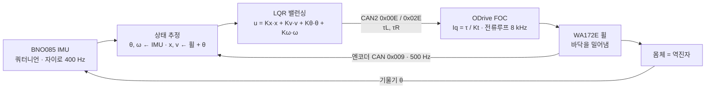

# 02 — 코드 해설 · 원리 · 이론 (CAN · MIT 모드 · FOC · 역진자 · LQR · CRC · ROS 2)

> 출처: [2학기 통합본 발표](../presentations/2026-2-integrated/) PART 07 (슬라이드 77–98)
> 앞 문서: [01 CAN 통합 구동 계획](01-can-integration-plan.md) · 다음: [03 운용 방법](03-operation-manual.md)
> 코드 조각은 발표에 실린 요약본이다. 통합 펌웨어 소스는 저장소에 아직 포함되지 않았다.

## 목차

1. [전체 신호 흐름](#1-전체-신호-흐름)
2. [CAN 통신 원리](#2-can-통신-원리)
3. [밸런싱 — 역진자 · LQR](#3-밸런싱--역진자--lqr)
4. [고관절 — MIT 모드 · 중력보상](#4-고관절--mit-모드--중력보상)
5. [휠 — FOC · ODrive](#5-휠--foc--odrive)
6. [안전 — 상태머신 · 3중 워치독](#6-안전--상태머신--3중-워치독)
7. [시리얼 패킷 · ROS 2](#7-시리얼-패킷--ros-2)
8. [단품 시험 스케치](#8-단품-시험-스케치)

---

## 1. 전체 신호 흐름



```
고관절 루프:  /twlr/height [mm] → heightToPhi (LUT 보간) → RateLimiter (0.35 rad/s) → MIT 프레임 (Kp · Kd · τff) → DM4340P 내부 PD + 40:1
```

**핵심 구조** — 휠은 Teensy 가 직접 루프를 닫고(LQR, 500 Hz), 고관절은 목표와 게인만 주면 DM4340P 내부에서 위치 루프가 닫힌다.

## 2. CAN 통신 원리

| 주제 | 요점 |
|---|---|
| **물리층** | CANH / CANL 두 선의 **전압 차**로 0 / 1. 열성(1) = 둘 다 2.5 V, 우성(0) = 3.5 V / 1.5 V. 꼬아서 배선하면 모터 잡음이 두 선에 똑같이 실려 차이에서 지워짐. 한 노드라도 0을 내면 버스 전체가 0 |
| **트랜시버** | SN65HVD230 이 Teensy 3.3 V TX/RX 를 차동 신호로 변환 (CAN1: 핀 22 CTX1 / 23 CRX1). 양 끝 120 Ω, 전원 OFF 에서 60 Ω 확인 |
| **프레임** | SOF · 11 bit ID · DLC · 데이터 ≤ 8 B · CRC · ACK. 약 130 bit → 1 Mbps 에서 130 µs |
| **중재** | ID 를 한 비트씩 내보내며 버스를 같이 봄 → 0 이 이기므로 **ID 가 작을수록 우선**, 진 쪽은 즉시 물러났다 재전송. 충돌해도 데이터가 깨지지 않음 |
| **ACK** | 받는 쪽이 하나도 없으면 송신자가 계속 재전송 → 모터 전원이 꺼져 있으면 버스가 막히고 피드백이 끊겨 FAULT |

**FlexCAN_T4 (Teensy 4.1)** — `FlexCAN_T4<CAN1, RX_SIZE_256, TX_SIZE_16>`, `setBaudRate(1000000)`.
하드웨어 FIFO 가 받고 → 인터럽트가 소프트웨어 큐로 복사만 → `loop()` 맨 앞에서 `while (can1.events() >> 12) {}` 로 비우며 해석.
인터럽트 안에서는 복사만 하므로 제어 계산이 중간에 끊기지 않는다.

## 3. 밸런싱 — 역진자 · LQR

### 자세 추정 (BNO085)

| 센서 | 장점 | 단점 | 사용 |
|---|---|---|---|
| 자이로 | 빠르고 정확한 각속도 | 적분하면 드리프트 | ✅ |
| 가속도 | 중력 방향 = 기준 | 가속 · 진동에 흔들림 | ✅ |
| 지자기 | 방위 | 모터 자석 · 전류로 왜곡 | ✗ → **Game Rotation Vector** |

```cpp
// imu.h — 쿼터니언 → 피치 (ZYX)
float s = 2*(qw*qy - qz*qx);
pitch_ = asinf(clamp(s, -1, 1));
float pitchRate() { return SIGN * gy; }   // 각속도는 미분하지 않고 자이로 직접
```

- θ 를 2 ms 마다 미분하면 잡음이 500 배 → ω 는 자이로 값을 그대로 사용 (Kω 항이 깨끗해야 떨림이 없음)
- **θ_eq** = 무게중심이 휠축 바로 위일 때의 IMU 피치. 장착 기울기 · 무게 배치 때문에 0 이 아니므로 실측

### 바퀴 달린 역진자

```
(Mw + Mb + Iw/r²)·a + Mb·l·α = τ / r
Mb·l·a + (Ib + Mb·l²)·α − Mb·g·l·θ = −τ          (sin θ ≈ θ 선형화)

TWLR 값 대입 →  a = −9.71 θ + 2.34 τ
               α =  57.6 θ − 8.33 τ           열린 루프 극점 ±7.59 rad/s → 불안정
```

| 기호 | 값 |
|---|---|
| Mb 몸체 | 6.84 kg |
| l 무게중심 높이 (휠축 위) | 0.305 m |
| Mw 휠 + 다리 | 4.40 kg |
| r 휠 반경 | 0.086 m |
| Iw · Ib (추정) | 0.0085 · 0.07 kg·m² |

제어가 없으면 기울기가 **0.091 s 마다 2 배**(e^7.59t = 2) → 2° 에서 0.4 s 만에 넘어짐.
제어 주기 2 ms 는 이보다 45 배 빠르다 — **밸런싱 루프를 리눅스가 아니라 Teensy 에서 돌리는 이유**.

### LQR

```
J = ∫ (xᵀQx + uᵀRu) dt,   x = [x, v, θ, ω],  Q = diag(5, 2, 200, 5),  R = 1
AᵀP + PA − PBR⁻¹BᵀP + Q = 0   →   K = R⁻¹BᵀP,  u = −Kx
```

```matlab
A = [0 1 0 0; 0 0 -9.71 0; 0 0 0 1; 0 0 57.6 0];
B = [0; 2.34; 0; -8.33];
K = lqr(A, B, diag([5 2 200 5]), 1)     % → -2.24 -4.10 -28.4 -4.59
```

- 닫힌 루프 극점 −20.8 · −6.4 · −0.74 ± 0.6j → 모두 좌반면. 가장 느린 −0.74 는 위치 복귀(≈1.4 s)
- `Kx = √(Qx/R) = √5 = 2.24` — 위치 게인은 Qx 로 바로 정해짐
- **Kx 와 Kθ 부호가 같다** (비최소위상): 앞으로 가려면 바퀴가 먼저 살짝 뒤로 가서 몸체를 앞으로 기울인 뒤 따라간다
- 검산: θ = 5° → u = 28.4 × 0.0873 = 2.48 N·m (PC 테스트 출력과 일치)
- 토르소 실측 질량이 나오면 위 세 줄로 Simulink 모델에서 바로 재계산

| 키우면 | 효과 |
|---|---|
| Q_θ | 기울기 빨리 복원 · 토크 ↑ · 떨림 위험 |
| Q_x | 제자리 유지 강함 · 흔들림 ↑ |
| R | 토크 아낌 · 반응 느려짐 |

### 수식 → 코드 (`Balancer::step()`)

```cpp
x = R_W * (phiw + theta);                  // [1] 엔코더는 몸체 기준 → +θ 로 바닥 기준 보정
v = R_W * (wv + theta_dot);
v_cmd  = clampf(in.v_cmd, -0.6f, 0.6f);    // [2] 속도 제한
x_ref_ += v_cmd * in.dt;                   // [3] 목표 위치를 밀어 줌 → "따라오기"가 곧 주행
x_ref_ = clampf(x_ref_, x - 0.3f, x + 0.3f);  // [4] 와인드업 방지 (밀려도 오차 ≤ 0.3 m)
u = K_X*(x - x_ref_) + K_V*(v - v_cmd)
  + K_TH*(theta - THETA_EQ) + K_W*theta_dot;  // [5] LQR
diff  = K_YAW * (w_cmd - yaw_rate);        // [6] 선회
tau_L = clampf(0.5f*u - 0.5f*diff, -8, 8); // [7] 분배 · 포화 (전류 10 A 안)
tau_R = clampf(0.5f*u + 0.5f*diff, -8, 8);
tx2(wheelL.setInputTorque(WHEEL_DIR_L * tau_L));  // [8] 모터가 마주 보고 달려 한쪽은 −1
```

## 4. 고관절 — MIT 모드 · 중력보상

### 비트 패킹 (고정소수점)

`u = round((x − xmin)·(2ⁿ − 1)/(xmax − xmin))` — 예: p = 1.0 rad → 13.5 × 65535 / 25 = 35 389 = `0x8A3D` → D0 = `8A`, D1 = `3D`.
12 bit 값 두 개는 바이트를 반씩 나눠 쓴다: `f.data[3] = ((V & 0xF) << 4) | (KP >> 8);`
**PMAX · VMAX · TMAX 가 모터 설정과 다르면 모든 값이 비례해서 틀어지므로** `config.h` = 디버깅 툴(12.5 / 8 / 28).

### MIT 모드 = 가상 스프링 · 댐퍼

```
τ = Kp(φd − φ) − Kd·ω + τff,   J·α = τ − τg
ωn = √(Kp/J),   ζ = Kd / (2√(Kp·J))
```

| 상태 | J [kg·m²] | Kd | ζ | ωn |
|---|---|---:|---|---|
| 공중 READY | ≈ 0.02 | 1.5 | 0.84 | 45 rad/s · 7 Hz |
| 서 있음 BALANCE | 0.21 – 0.28 | **3.0** | 0.45 – 0.52 | 12 – 14 rad/s · 2 Hz |

서 있으면 몸무게가 실려 J 가 10 배 이상 커진다 → 같은 Kd 1.5 면 ζ < 0.3 으로 출렁 → **서 있을 때 Kd 3.0** (Kp 40, 계단 응답 비교: Kd 1.0 출렁 · 3.0 채택 · 5.0 느림).

### 중력보상 · LUT · 변화율 제한

- **중력보상** — τff 없이 Kp 40 으로만 버티면 455 mm 에서 정지 오차 8.98 / 40 = 0.22 rad(**12.9°**). τff = 0.8 τg 를 넣으면 2.6° 로 감소. 0.8 은 모델 오차 시 과보상으로 다리가 튀지 않게 하려는 값
- **LUT** — CAD 질량모델의 각도별 필요 토크 7점을 선형보간. 455 mm: t = (455 − 422)/(475 − 422) = 0.623 → Δφ 6.23°, τ = 8.98 N·m → × 0.8 = **7.18 N·m**
- **변화율 제한** — 0.35 rad/s(≈20°/s), 한 스텝 0.04°. 455 → 300 mm 는 약 1.2 s 에 걸쳐 내려앉음
- **램프** — BALANCE 진입 시 τff 를 0.5 s 에 걸쳐 0 → 100 %

```cpp
phi_des = hipTraj.step(heightToPhi(h), HIP_RATE_MAX, dt);   // ① 높이 → 각도 → 천천히
ff_ramp = loaded ? clampf(ff_ramp + dt / 0.5f, 0, 1) : 0;    // ② 서 있을 때만 0.5 s 에 걸쳐 켬
tffL    = ff_ramp * gravityTau(hipPhi(hipL, DM_DIR_L));      // ③ 지금 각도의 중력 토크 × 0.8
```

## 5. 휠 — FOC · ODrive

- **τ = Kt · Iq** — 전류를 회전자 자석(d축)과 90°인 q축으로 흘릴 때 힘이 최대(Id = 0). WA172E 는 Kt = 1 N·m/A → 2 N·m 명령 = 2 A
- ODrive 안: `setInputTorque(τ)` → Iq* = τ/Kt → 전류 PI 8 kHz(Clarke/Park) → SVM PWM. ODrive 의 위치 · 속도 루프는 쓰지 않고 Teensy LQR 이 그 역할
- **왜 켤 때마다 캘리브레이션?** θe = 15 × θm + 오프셋. 증분 엔코더(인덱스 없음)는 켜진 순간 위치를 모름 → state 7 로 오프셋 측정(≈3 s)

| 오프셋 오차 (기계각) | 전기각 | 토크 |
|---|---|---|
| 1° | 15° | 97 % |
| 3° | 45° | 71 % |
| 6° | 90° | **0 % — 안 돎** |

- 3200 CPR → 기계각 0.11° · 전기각 1.7° · 바퀴 이동 0.17 mm 단위
- **CAN 메시지** — 11 bit ID = node 6 bit | cmd 5 bit. 오른쪽 휠 토크: (1 << 5) | 0x0E = 46 = `0x02E`.
  값은 IEEE 754 float 리틀엔디안: 1.5 N·m = `0x3FC00000` → `00 00 C0 3F`. Teensy 도 리틀엔디안이라 `memcpy` 한 줄
- **ODrive 워치독** — 그 축으로 0.2 s 동안 CAN 메시지가 없으면 축 IDLE. READY 에서도 20 Hz 버스전압 요청이 워치독을 먹여 줌. CAN 구동 확인 후 켬
- 설정 스크립트 줄별 해설은 [`host/odrive_can_setup.odrivetool.py`](../../host/odrive_can_setup.odrivetool.py) 주석 참고

## 6. 안전 — 상태머신 · 3중 워치독

```cpp
void loop() {
  while (can1.events() >> 12) {}  while (can2.events() >> 12) {}   // [1] CAN 수신 비우기
  imu.poll(now);   readHost(now);                                  // [2] IMU · 호스트 명령(CRC 확인)
  if (now_us - last_ctrl_us >= CTRL_PERIOD_US) controlStep(el * 1e-6f, now);  // [3] 정확히 500 Hz
  if (now - last_tel_ms >= TELEM_PERIOD_MS) sendTelemetry(now);    // [4] 100 Hz
}
// controlStep: enable 은 마지막 값 유지 → 매 주기 checkHealth() → 활성 모드면 즉시 FAULT
//   IDLE   disable 프레임만 보내 각도 읽기, enable 오면 휠 엔코더 캘리브 시작
//   CALIB  하트비트 state 가 IDLE 로 돌아오면 → 토크모드 폐루프 + 고관절 enable → READY
//   READY  높이만 유지 (Kd 1.5), balance 명령 + 균형각 10°(0.17 rad) 이내 → BALANCE
//   BALANCE 35°(0.61 rad) 초과 → FAULT(F_FALL), 아니면 Kd 3.0 + 중력보상 + LQR
//   FAULT  휠 IDLE · 고관절 Kp 0 Kd 1 댐핑 1 s → disable, enable false 로 리셋
```

| 멈춘 곳 | 알아채는 곳 | 시간 | 그 다음 |
|---|---|---|---|
| LattePanda · ROS | Teensy | 250 ms | v = 0 · 제자리 균형 유지 (enable · balance 유지) |
| Teensy | DM4340P | 100 ms | 모터 스스로 Disable (CAN Timeout 2000 × 50 µs) |
| Teensy | ODrive | 0.2 s | 축 IDLE (watchdog) → 휠 토크 0 |
| DM 응답 없음 · state ≥ 8 | Teensy | 30 ms | FAULT: 휠 IDLE · 고관절 1 s 댐핑 → Disable |
| ODrive 응답 없음 · 에러 | Teensy | 300 ms | FAULT |
| IMU 멈춤 · 기울기 35° 초과 | Teensy | 50 ms · 즉시 | FAULT (넘어짐) |

고관절을 바로 끄면 다리가 털썩 접히므로 1 s 동안 천천히 힘을 뺀다. FAULT 원인 비트는 래치되어 사후 확인 가능.

## 7. 시리얼 패킷 · ROS 2

**실제 Command 패킷 (22 B, C++ 과 Python 교차 테스트 값)**

```
A5 5A | 02 | 10 | 07 00 | 01 | 00 | 00 00 80 3E | 00 00 00 BF | 00 80 E3 43 | 8D 96
sync   type len  seq=7   en   bal   v=0.25 m/s    w=−0.5 rad/s   h=455 mm     CRC 0x968D
```

- **CRC16-CCITT** G(x) = x¹⁶ + x¹² + x⁵ + 1, init 0xFFFF. 1·2 비트, 홀수 개, 16 비트 이하 연속 오류는 100 % 검출, 그 밖은 1/65 536 확률로만 통과
- **파서** — `A5 5A` 찾기 → type · len → len + 2 바이트 대기 → CRC 불일치면 2 바이트 버리고 다시 찾기. USB 가 바이트를 잘라 보내거나 중간부터 읽어도 스스로 복구
- **배치 일치** — C++ `#pragma pack(push, 1)` 구조체 ↔ Python `struct.pack('<HBBfff', …)` (리틀엔디안 · 패딩 없음, 2+1+1+4×3 = 16 B)

**ROS 2 브리지 (`bridge_node.py`)**

| 흐름 | 동작 |
|---|---|
| `/cmd_vel` 콜백 | 속도 저장 + 받은 시각 기록 |
| 50 Hz 타이머 `send_command` | 1 s 동안 새 `/cmd_vel` 없으면 v = w = 0 (키를 떼면 정지) → 22 B 패킷 송신 (lock) |
| 수신 스레드 `read_loop` | 시리얼 읽기는 대기 동작이라 ROS 콜백과 분리 → 파서 → 92 B Telemetry 만 사용 |
| `publish` | `/imu/data` · `/joint_states` · `/twlr/pitch` · `/twlr/battery` · `/odom` + TF |

**오도메트리** — 바닥 기준 바퀴 속도 = 엔코더 + 피치 각속도(엔코더가 몸체 기준이므로)

```
v = r(ωL + ωR)/2,   ωz = r(ωR − ωL)/b   (b = 0.515 m)
ψ += ωz·Δt,  x += v·cos ψ·Δt,  y += v·sin ψ·Δt      (100 Hz 텔레메트리마다 적분)
```

바퀴 미끄러짐 · 적분 오차가 쌓이므로 이후 라이다 SLAM 이 보정한다. 노드 사이는 DDS 가 자동으로 찾아 연결하므로(토픽 = 이름 붙은 채널) SLAM · 자율주행 노드를 그대로 붙일 수 있다.

## 8. 단품 시험 스케치

통합 전에 모터를 하나씩 확인한다. 시리얼 모니터에서 키 하나 = CAN 프레임 하나.

| 키 | `dm_single_test` 가 보내는 것 | 확인할 것 |
|---|---|---|
| `e` | enable() → ID 0x01: FF×7 FC | state 0 → 1 |
| `d` | disable() → FF×7 FD | 힘이 빠짐, 각도는 계속 읽힘 |
| `z` | disable → setZero() FF×7 FE | 지금 각도가 0 rad 로 저장 (**기준 자세에서만**) |
| `h` | mit(현재각, 0, Kp 10, Kd 0.5, 0) | 손으로 밀면 스프링처럼 버팀 |
| `s` | mit(p₀ + 0.15·sin πt, 0, 20, 1, 0) | ±8.6°, 0.5 Hz 추종 |
| `0` | 3 s 동안 0 rad 로 선형 이동 | 영점으로 천천히 복귀 |
| `p` | 100 ms 마다 상태 출력 on / off | state · pos · τ · 온도 · age |

| 키 | `odrive_can_test` 가 보내는 것 | 확인할 것 |
|---|---|---|
| `c` | setState(7) → 0x007 / 0x027 | 바퀴가 천천히 돌며 오프셋 측정 |
| `l` | 속도모드 · VEL_RAMP → setState(8) | state = 8 (폐루프) |
| `v` | setInputVel(±0.5) 0x00D / 0x02D | 두 바퀴가 같은 방향으로 회전 (거울 배치라 부호 반대) |
| `s` | setInputVel(0) | 정지 |
| `t` | 토크모드 → setInputTorque(±0.3) | 살짝 미는 힘 |
| `i` | setState(1) IDLE | 힘이 빠짐 |
| `x` | clearErrors() 0x018 / 0x038 | axis_error 0 |

- DM 은 명령 1개를 받아야 피드백 1개를 돌려준다 → 힘을 빼 둔 상태에서도 200 Hz 로 disable 을 계속 보내 각도 · 온도를 읽는다. **age 가 계속 커지면 배선 · ID · 120 Ω 확인**
- `odrive_can_test` 는 50 ms 마다 버스 전압을 RTR 로 물어 ODrive 워치독도 함께 먹여 준다
