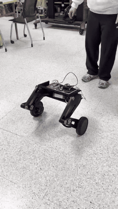

# 04 — 실물 밸런싱 성공 (2026-11-22, Teensy 제어 v3)

<p align="center"></p>

영상: [바닥 밸런싱 (20 s)](../../hardware/media/balancing-2026-11-22-floor.mp4) ·
[시험 장면 — 측면 저각도 (63 s)](../../hardware/media/balancing-2026-11-22-test.mp4) (원본 HEVC 1080p → H.264 720p, 음성 제거)

코드: [`twlr_balance/`](../../twlr_balance/) — 펌웨어 [`twlr_balance/firmware/twlr_bridge/twlr_bridge.ino`](../../twlr_balance/firmware/twlr_bridge/twlr_bridge.ino)

---

## 1. 지금 구조 — ROS 2 를 쓰지 않음

**현재 실물 밸런싱은 ROS 2 없이 돈다.** Khadas 에서는 일반 파이썬 스크립트(`main_teensy.py`, pyserial + 터미널 키 입력)가
Teensy 와 USB 시리얼로 명령·상태만 주고받고, **밸런싱 계산 · 바퀴 명령 · 안전 판정은 전부 Teensy 안에서** 돈다.
코드 어디에도 `rclpy` / ROS 2 의존성이 없다.

```
[Teensy 4.1]  twlr_bridge.ino v3          CAN1 1 Mbps 하나 = 힙 DM4340P ×2 (ID 1/2, MIT) + ODrive (노드 3 = 왼쪽 axis0, 4 = 오른쪽 axis1)
   500 Hz : 힙 홀드 (MIT, Kp 100 / Kd 2) + BNO085 읽기 (I²C, 200 Hz 리포트)
   250 Hz : CoM 추정 → 두 겹 제어기 → ODrive 속도명령(CAN) + 엔코더 요청(RTR) + 안전 판정
      │ USB 시리얼  Teensy→PC 107 B @250 Hz  /  PC→Teensy 12 B 명령 (sum8 체크섬)
[Khadas VIM4]  main_teensy.py   키보드 → 명령·게인, 상태줄, CSV 로그 (~/logs/tbal_*.csv)
```

### 10월 계획 문서([01](01-can-integration-plan.md))와 달라진 점

| 항목 | 10월 계획 | 실제 구현 (11-22) |
|---|---|---|
| 상위 통신 | LattePanda **ROS 2** 노드, CRC16, `/imu/data` `/joint_states` `/odom` | Khadas **일반 파이썬**, sum8, CSV 로그 |
| CAN 버스 | CAN1 = 힙, CAN2 = 휠 (분리) | **CAN1 하나**에 힙 + ODrive (ID 겹치지 않음: DM 0x01~0x1F, ODrive node<<5 ≥ 0x60) |
| ODrive 모드 | 토크 모드 | **속도 모드** (가속도 → 속도 적분 → `Set_Input_Vel`) |
| 밸런싱 위치 | Teensy 500 Hz | Teensy **250 Hz** (힙 500 Hz 의 2 주기마다) |
| 제어기 | LQR K = 2.24/4.10/28.4/4.59, 휠 토크 출력 | **두 겹 PID** (속도 PI → 기울기 PD), 가속도 출력. 기본 게인 = LQR 등가 |
| 워치독 | ROS 250 ms · DM 100 ms · ODrive 0.2 s | PC 300 ms (Teensy 판정) · DM 피드백 50 ms · **ODrive 워치독 꺼짐** |

v2(11-22 오전, 파이썬이 ODrive 를 USB 로 100 Hz 제어)는 루프 지터 문제로 밸런싱 계산을 Teensy 로 옮긴 것이 v3 이다.
v2 는 `main.py` 로 그대로 남아 있음 (CAN 이 계속 끊길 때 백업).

## 2. 제어식

```
th_CoM = IMU_SIGN·pitch − IMU_MOUNT + COM_SIGN·θoff(Δφ) + trim          θoff(Δφ) = 6.188 − 0.1781Δφ + 0.002189Δφ² − 0.000333Δφ³  [deg]
th_ref = −( KPv·(v − v_ref) + KIv·∫(v − v_ref)dt )                       (바깥: 속도 PI → 목표 기울기, |th_ref| ≤ 8°)
a      = GAIN · ( KPth·(th_CoM − th_ref) + KDth·ω_CoM )                  (안쪽: 기울기 PD → 바퀴 가속도, |a| ≤ 6 m/s²)
v_cmd += a·dt            (|v_cmd| ≤ 1 m/s)
바퀴 L/R = DIR·(v_cmd ∓ yaw_ref·TRACK/2) / (2π·R)   [turns/s]
```

## 3. 성공 당시 확정 설정 (`twlr_balance/config.py`)

| 값 | 설정 | 비고 |
|---|---|---|
| `IMU_SIGN` | +1 | 앞으로 기울이면 + 확인 |
| `WHEEL_DIR` | (−1, −1) | 앞으로 굴리면 ODrive 값이 − |
| `HIP_KP` | 100 | 60 에서는 다리가 약 6° 처짐 (fault 기준 10° 에 근접) |
| `PID_I_MAX` | 2.0 | 균형점 오차 자동 보정 범위 확대 |
| 게인 | KPth 27.9 / KDth 4.65 / KPv 0.078 / KIv 0.036 | 기본값(LQR 등가) 그대로 성공 |
| `COM_TRIM_DEG` | **미기록** | 다음 시험 때 상태줄 `trim` 값을 적어 넣으면 `c` 생략 가능 |

> 업로드된 v3 압축본의 `config.py` 는 `HIP_KP = 60`, `PID_I_MAX = 0.5` 였다. 실행 순서 메모의 확정값(100 / 2.0)으로 저장소에 반영함.
> Khadas 의 실제 파일과 같은지 한 번 확인할 것.

## 4. 실행 순서

```bash
# 1. 노트북 → Khadas
ssh khadas@192.168.0.14
# 2. 작업 폴더 (접속할 때마다)
cd ~/twlr_balance && source ~/odrive-env/bin/activate
# 3. ODrive 재부팅 (전원 켠 직후 / 상태줄 od=-- 일 때) — 바퀴 띄우기(엔코더 캘리브로 바퀴가 돎), 힙 24 V 서플라이 확인
odrivetool          # odrv0.reboot()  →  quit()
# 4. 센서 확인 — IMU ok=1 / 살아있음 L=1 R=1 / 하트비트 20 Hz / 엔코더 응답 ~470 Hz, 끝: q
python3 tools/check_sensors.py --no-odrive
# 5. 밸런싱
python3 main_teensy.py
```

1. 상태줄 `od=LR` 확인
2. `e` → 다리 자세 맞추기 → `h` (상태줄 `hip=7`)
3. 바닥에서 **살짝 앞으로 기울인** 균형점에서 `c` (thCoM ≈ 0)
4. `b` (BAL) — 비상정지: 스페이스 / `x`, 종료: `q`

| 키 | 동작 |
|---|---|
| `-` `=` | 전체 게인 ×0.9 / ×1.1 (빠르게 덜덜 → `-`, 천천히 쓰러짐 → `=`) |
| `[` `]` | 균형점 −/+0.2° (뒤로 굴러가면 `[`, 앞으로 가면 `]`) |
| `1`~`4` 후 `,` `.` | 개별 게인 선택 후 ×0.9 / ×1.1 |
| `i` `k` / `j` `l` / `o` | 전진·후진 ±0.05 m/s / 좌·우 회전 ±0.2 rad/s / 정지 |

다시 시작: `hip=7`(넘어짐 등) → 세우고 `c` → `b` · `hip=0`(`x` 누름 등) → `e` → `h` → `c` → `b`

### 펌웨어 다시 올리기 (필요할 때만)
```bash
cd ~/twlr_balance/firmware/twlr_bridge
arduino-cli compile --fqbn teensy:avr:teensy41 --output-dir ~/arduino/build/twlr_bridge .
teensy_loader_cli --mcu=TEENSY41 -w -v ~/arduino/build/twlr_bridge/twlr_bridge.ino.hex
```
→ 5 초 기다린 뒤 ODrive 재부팅. 업로드 직후 바로 실행하면 포트 에러.

### 백업 — CAN 이 계속 끊길 때 USB 로 바퀴 제어
`odrivetool` 을 끄고 `python3 main.py` (키 순서 동일: `e` → `h` → `c` → `b`)

### 노트북 ↔ Khadas
```powershell
scp -r khadas@192.168.0.14:~/twlr_balance $HOME\Downloads\twlr_balance_backup     # 백업 받기
scp "khadas@192.168.0.14:~/logs/tbal_*.csv" $HOME\Downloads\
scp $HOME\Downloads\twlr_balance_v3.zip khadas@192.168.0.14:~/                     # 새 버전 올리기
# (Khadas) cd ~ && rm -rf twlr_balance_old && mv twlr_balance twlr_balance_old && python3 -m zipfile -e twlr_balance_v3.zip ~/
```

## 5. 주의 / 알려진 문제

- Teensy USB 를 뽑았다 꽂으면 ODrive CAN 이 멈출 수 있음 → ODrive 재부팅
- **ODrive 가 넘어질 때 / 밸런싱 중 CAN 에서 빠지는 현상** (ODrive 에러는 없음) → CAN H/L 꼬기, GND 공통 연결, 전원 끈 상태에서 H–L 저항 약 60 Ω(종단 2개) 확인
- **ODrive 워치독 꺼짐**: Teensy 가 멈추면 바퀴가 마지막 속도로 계속 돌 수 있음 → 최후 수단은 배터리 분리
- Teensy 포트는 by-id 고정: `/dev/serial/by-id/usb-Teensyduino_USB_Serial_20585600-if00`
- 멀티미터로 배선 확인할 때 **합선(쇼트) 주의** — 전원 인가 상태에서 프로브로 인접 핀을 잇지 말 것

다음 단계(스쿼트 · 롤 · 선회 · ROS 2) → [05](05-next-motions-roadmap.md)
