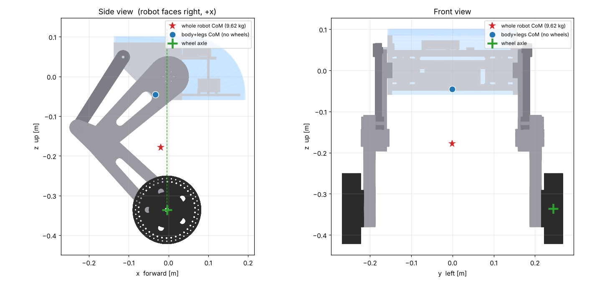

# twlr_description

CATIA 어셈블리(`assembly_urdfchange_.stp`)에서 자동 생성한 TWLR 로봇 모델 패키지입니다.
대상 환경: Ubuntu 24.04 + ROS 2 Jazzy + Gazebo Harmonic



## 설치 (처음 한 번)
```bash
sudo apt install ros-jazzy-xacro ros-jazzy-robot-state-publisher ros-jazzy-joint-state-publisher-gui \
                 ros-jazzy-rviz2 ros-jazzy-ros-gz
mkdir -p ~/twlr/src && cd ~/twlr/src
# 이 폴더(twlr_description)를 여기에 압축 해제
cd ~/twlr && colcon build --symlink-install
source install/setup.bash        # 새 터미널마다 실행 (또는 ~/.bashrc 에 추가)
```

## 실행
| 목적 | 명령 |
|---|---|
| 모델 확인 (RViz, 물리 없음) | `ros2 launch twlr_description display.launch.py` |
| 다리 관절 움직여보기 (RViz 슬라이더) | `ros2 launch twlr_description display.launch.py legs_fixed:=false` |
| Gazebo 시뮬레이션 (1단계, 다리 고정) | `ros2 launch twlr_description sim.launch.py` |
| 아크릴 없는 상태 | `ros2 launch twlr_description sim.launch.py acrylic_mass:=0.001` |
| 균형 자세로 시작 (앞으로 5.8° 숙임, 아크릴 포함) | `ros2 launch twlr_description sim.launch.py spawn_pitch:=0.101` |
| 바퀴 토크 부호 확인 | (sim 실행 중 다른 터미널) `ros2 run twlr_description wheel_torque_test.py` |

제어기가 아직 없으므로 **Gazebo에서 로봇이 넘어지는 것이 정상**입니다.

## ROS 2 토픽
| 토픽 | 방향 | 내용 |
|---|---|---|
| `/imu/data` | Gazebo → ROS | sensor_msgs/Imu, 400 Hz, imu_link 기준 |
| `/joint_states` | Gazebo → ROS | 바퀴(와 다리) 각도·각속도 |
| `/wheel_L/cmd_torque`, `/wheel_R/cmd_torque` | ROS → Gazebo | std_msgs/Float64 [N·m], **+ 가 전진** (좌우 모두) |

## 좌표계
- ROS 표준: x = 전진, y = 왼쪽, z = 위. (CATIA: 전진 = -y, 왼쪽 = +x, 위 = +z)
- base_link 원점 = 좌우 힙모터 축의 중간점
- 모든 관절 각도 0 = CATIA 어셈블리 자세
- 바퀴축은 base_link 기준 (x -0.004, z -0.336), 좌우 간격 0.488 m, 바퀴 반지름 0.086 m

## 링크 질량 (아크릴 포함 총 9.62 kg, 아크릴 기본값 0.515 kg)
| 링크 | 질량 [kg] | 무게중심 (링크 원점 기준, x y z) [m] |
|---|---|---|
| base_link | 2.807 | +0.0113, -0.0022, +0.0015 |
| thigh_L | 0.338 | -0.0961, +0.0038, -0.0906 |
| thigh_R | 0.338 | -0.0961, -0.0038, -0.0906 |
| shin_L | 0.473 | +0.0393, +0.0150, -0.0432 |
| coupler_L | 0.137 | -0.0564, +0.0129, -0.0875 |
| shin_R | 0.473 | +0.0386, -0.0152, -0.0424 |
| coupler_R | 0.137 | -0.0564, -0.0129, -0.0875 |
| wheel_L | 2.200 | +0.0000, +0.0000, +0.0000 |
| wheel_R | 2.200 | +0.0000, -0.0000, +0.0000 |
| acrylic_link | 실행 인자 | +0.0646, +0.0000, +0.0499 |

질량 출처: 출력물 = 슬라이서 값, 구매품 = 판매처 값, 나사 = 개수 × 개당 무게.
위치 정보가 없는 부품(강압기 70 g, USB 케이블 30 g, 전선 40 g, XT90 20 g, CAN 3 g, 분배기 5 g, 합 168 g)은
몸통 중앙 앞쪽 (x +0.05, z 0)에 점질량으로 넣었습니다. 실제 위치가 정해지면 다시 계산해서 반영.
전장품(LattePanda, ODrive, Teensy, IMU, 힙모터)의 **겉모양**은 박스/원기둥으로 단순화했습니다. 질량·무게중심은 실제 값 사용.

## 꼭 알아둘 것
1. **몸통이 수평일 때 무게중심이 바퀴축보다 뒤에 있습니다** (아크릴 포함 2.9 cm, 미포함 4.0 cm). 그래서 이 다리 자세에서 균형점은
   몸통이 **앞으로 약 5.8° 숙인 상태**입니다 (아크릴 없으면 8.2°). IMU pitch 0°는 균형점이 아닙니다.
2. 허브모터 2.2 kg × 2 = 전체의 48 %. 허브모터 전체(고정자 포함)를 바퀴 회전부로 넣었으므로 바퀴 회전 관성은 실제보다 약간 큽니다.
3. 아래 값은 **임시값**이라 데이터시트 확인 후 xacro 상단에서 수정: 힙 관절 각도 범위(±0.8 rad), 휠모터 토크 한계는 ODrive current_lim 10 A × Kt 1 = 10 N·m로 설정(정격 5, 최대 13 N·m).
4. `legs_fixed:=false`의 4절 링크 닫힘 조인트(closure)는 2단계에서 Gazebo 검증 필요.
5. IMU는 몸통과 같은 방향으로 장착됐다고 가정. 실물 장착 방향이 다르면 `imu_joint`의 rpy 수정.
